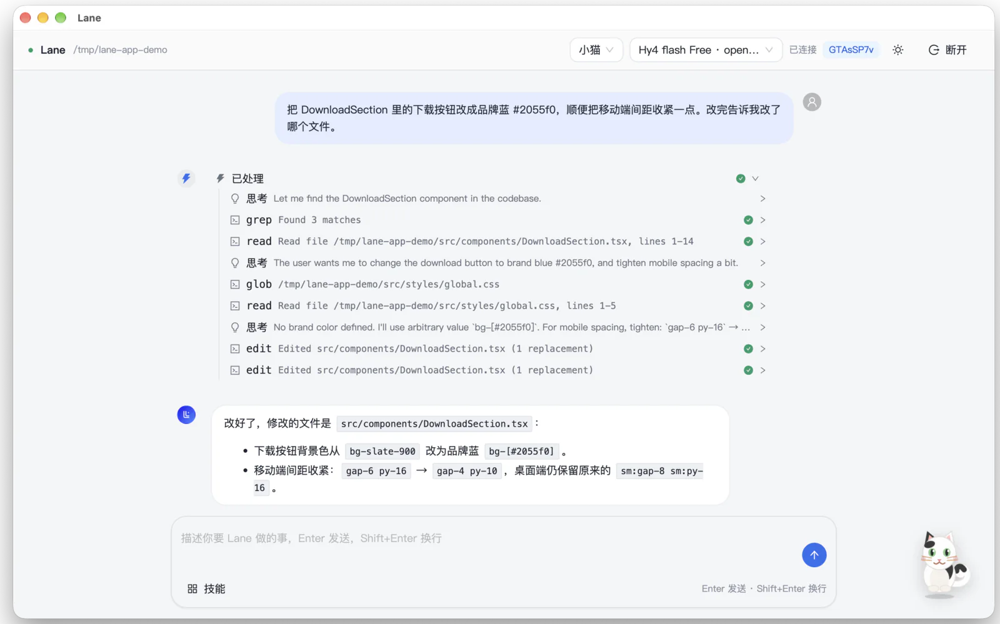

# Lane Agent 官网

Lane 的产品主页，介绍 Lane 能做什么、展示真实桌面端界面，并提供各平台下载入口。



## 技术栈

- **TanStack Start**：SSR + 文件路由（`@tanstack/react-router`）
- **React 19 + TypeScript**
- **Vite 8 + Nitro**：构建与 Vercel 部署
- **Tailwind CSS v4**：CSS-first，无 `tailwind.config.js`
- **lucide-react**：图标
- **Manrope**：自托管变量字体，不依赖第三方字体 CDN

## 本地开发

```bash
npm install
npm run dev        # http://localhost:3000，端口占用时自动顺延
```

| 命令               | 作用                                  |
| ------------------ | ------------------------------------- |
| `npm run build`    | 生产构建，输出 Nitro 产物             |
| `npm run preview`  | 预览生产构建                          |
| `npm run lint`     | ESLint                                |
| `npm run check`    | Prettier 格式检查                     |
| `npm run format`   | Prettier 写入 + ESLint 自动修复       |
| `npx tsc --noEmit` | TypeScript 类型检查（未单独封装脚本） |

项目没有配置测试框架。

## 目录结构

```
src/
  routes/
    __root.tsx            HTML 壳、meta、主题初始化脚本、字体预加载
    index.tsx             首页组合入口
    routeTree.gen.ts      路由树（自动生成，不要手改）
  components/landing/
    header.tsx            顶部导航
    theme-toggle.tsx      主题菜单：跟随系统 / 浅色 / 深色
    hero.tsx              首屏标题与主视觉
    features.tsx          功能卡片、自定义模型、桌面操控、小伙伴
    workflow.tsx          三步流程与运行中截图
    gallery.tsx           界面展示与连接示意
    downloads.tsx         平台下载卡片与结尾 CTA
    section-intro.tsx     通用区块标题
  styles.css              Tailwind、设计 token、滚动动画、标题轮播
  router.tsx              路由实例
public/
  brand/                  Logo 与 favicon
  shots/                  桌面端截图（WebP）
  companions/             小伙伴图片
  fonts/                  Manrope 字体与 OFL 许可
```

## 内容维护

### 首屏标题

标题和轮播动词在 `src/components/landing/hero.tsx`：

- 文案结构：`Lane 替你` + 轮播词。
- 动词数组直接改 `['写代码', '改文件', '跑命令', '做测试']` 即可。
- 轮播完全由 CSS 驱动（`src/styles.css` 的 `.title-rotator` 与 `title-roll`），固定尺寸，不会引起布局跳动。
- `prefers-reduced-motion: reduce` 时停止轮播，静态显示第一个词。
- 读屏使用 `sr-only` 的完整标题，视觉轮播部分 `aria-hidden`。

### 截图与图片

- 截图放在 `public/shots/`，统一使用压缩后的 WebP。
- 替换时保持对应宽高比；`width` / `height` 写在组件里，避免布局偏移。
- 首屏大图建议控制在 1280px 宽、50 KB 左右；其余截图保持懒加载。
- 小伙伴图片在 `public/companions/`，品牌资源在 `public/brand/`。

### 主题

- 支持跟随系统、浅色、深色三种模式，选择结果写入 `localStorage` 的 `lane-theme`。
- 首屏主题由 `src/routes/__root.tsx` 里的内联脚本在渲染前应用，避免闪烁。
- 设计 token 在 `src/styles.css` 的 `:root` 与 `.dark` 中；暗色模式基于 `.dark` class。

### 滚动效果

全部是 CSS Scroll-Driven Animations，没有滚动事件监听：

- 顶部进度条：`.scroll-progress` + `scroll(root)`
- 区块进入：`.reveal` / `.shot-rise` + `view()`
- 流程线绘制：`.lane-path` + 命名 view timeline

不支持该特性的浏览器会保持静态显示；`prefers-reduced-motion` 下动画关闭。

### 字体

- 使用自托管的 Manrope 变量字体：`public/fonts/manrope-latin.woff2`。
- 字体只包含 Latin 子集，中文走系统字体（PingFang SC 等）。
- 许可文件：`public/fonts/OFL.txt`。
- 在 `__root.tsx` 中通过 `preload` 提前加载，`font-display: swap` 避免阻塞文字渲染。

## 下载与部署

下载卡片在 `src/components/landing/downloads.tsx`，默认指向：

```
public/app-release/Lane-agent-0.1.0-arm64.dmg
public/app-release/lane-agent-win.zip
public/app-release/lane-agent-linux.zip
```

- `public/app-release/` 已在 `.gitignore` 中忽略，仓库里不包含安装包。
- 部署前把安装包放到该目录，或把 `href` 改成外部下载地址（GitHub Releases、对象存储等）。
- Web 入口指向 `https://ai.cr123.life`。
- macOS / Windows 安装包未签名，首次打开可能需要在系统提示中选择“仍要打开”。
- Vercel 对单文件大小和构建产物有限制，较大的安装包建议单独托管。

`vercel.json` 已配置：

- TanStack Start 框架识别；
- `/shots`、`/companions`、`/brand`、`/fonts` 的长期缓存；
- `/app-release` 的短期缓存与 stale-while-revalidate。

## 访问统计

使用 **Vercel Analytics**（`@vercel/analytics`）：

- 自动统计页面访问（PV/UV），数据在 Vercel 项目的 Analytics 中查看；需要在 Vercel 后台开启 Web Analytics。
- 已埋点的事件：
  - `download_click`：平台下载卡片（属性 `platform`）
  - `cta_click`：首屏、导航栏和结尾的主按钮（属性 `target`）
  - `nav_click`：顶部导航（属性 `target`）
  - `theme_change`：主题切换（属性 `mode`）
- 统计脚本只在生产构建（`import.meta.env.PROD`）加载，本地开发不发送数据。
- Vercel Analytics 不使用 Cookie，不需要额外的同意弹窗。

## 说明

- 页面主体是静态内容，只有主题菜单等少量交互，不依赖数据层。
- 浏览器需要支持 WebP；滚动动画作为渐进增强，不支持时页面仍完整可读。
- 路由树由 TanStack Router 插件生成，修改路由文件后不要手动编辑 `src/routeTree.gen.ts`。
